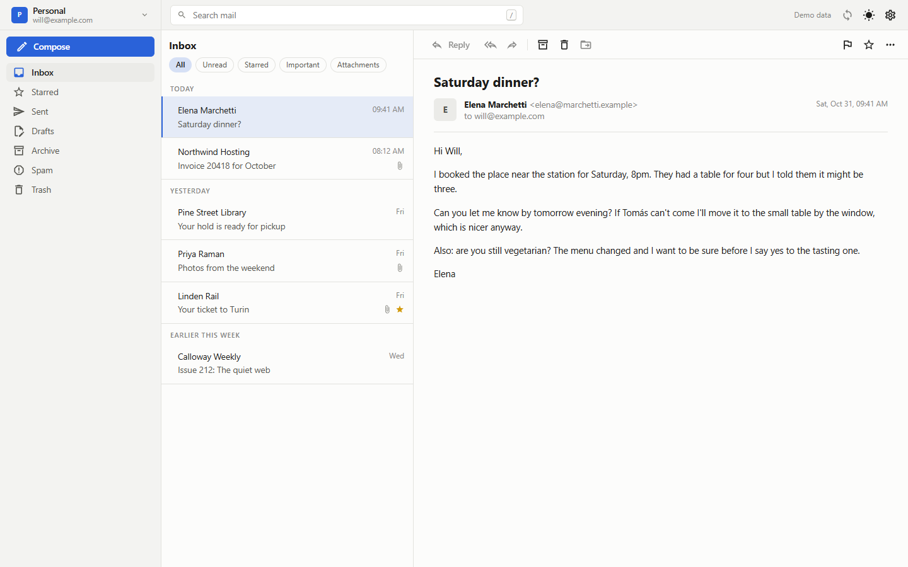
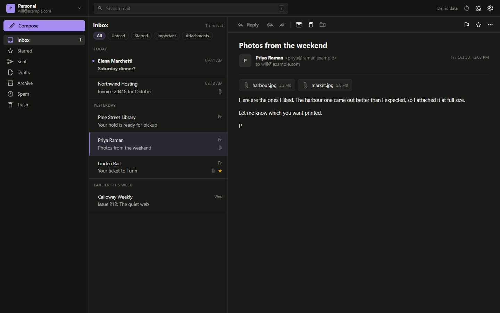
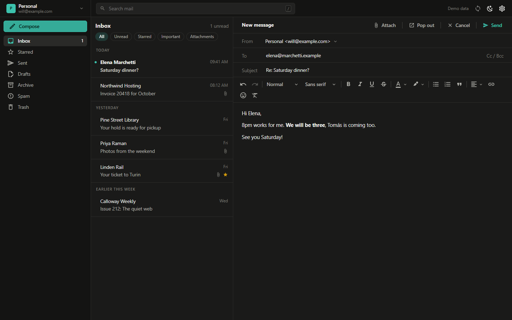
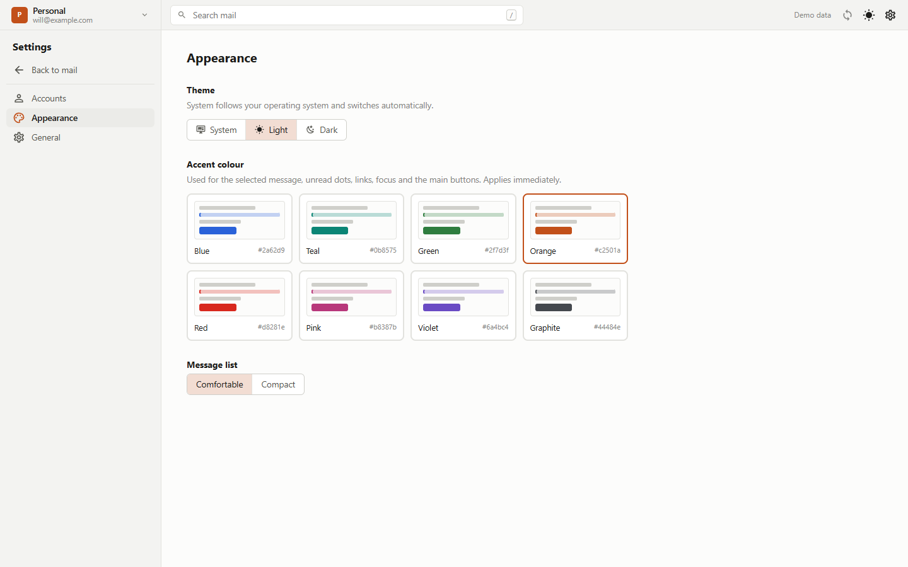
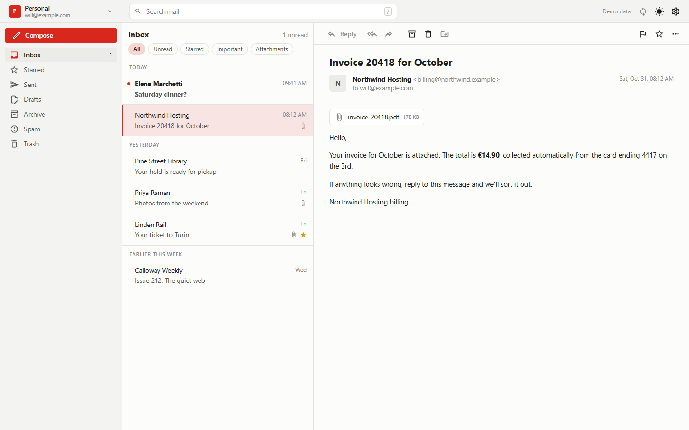
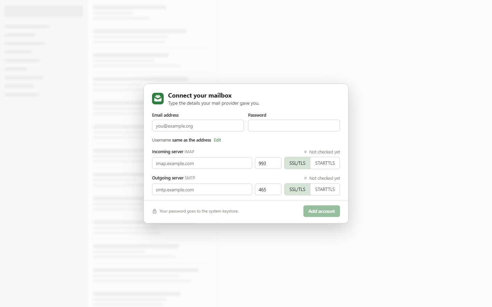

<h1 align="center">
  <br>
  Parsel
</h1>

<h3 align="center">
  A clean desktop mail client for your own mailbox.<br>
  No Electron. No cloud. No account but yours.
</h3>

<p align="center">
  Read and send mail over IMAP and SMTP from a native window on Windows and Linux.<br>
  Java does the mail, a Vue page draws the interface, and both run in <b>one process</b>.
</p>

<p align="center">
  <a href="https://github.com/B077AS/parsel/releases/latest"></a>
  
  
  <a href="https://github.com/B077AS/jolt"></a>
  
  
  
</p>

---

<p align="center">
  
  
</p>

Parsel is for people who run their own mail server, or use one they can set up by hand, and want a mail program that looks
and feels like a real desktop app. You type your server's details once. From then on your mail is read from a local cache, so
the window never waits on the network, and it syncs in the background.

## Why Parsel

- **Looks like an app, not a web page.** Flat surfaces, three panes (folders, list, reader), light and dark themes that follow
  your system, and eight accent colours.
- **Fast.** The window reads from a local SQLite cache and the sync runs behind it. Archiving or deleting a message
  disappears from the list at once; the server catches up in the background.
- **Careful with your mail.** Messages are cleaned and shown in a sandboxed frame with no scripts, and remote images (and the
  trackers hidden in them) stay blocked until you click *Load images*.
- **Careful with your password.** It goes to the system keystore (Windows Credential Manager, or the Secret Service on Linux),
  never to a file. Where there is no keystore, Parsel keeps an encrypted vault behind a master password.
- **Small.** The Windows installer is about 33 MB, with its own Java runtime inside. There is no bundled browser: Parsel uses the
  web view your system already has (WebView2 on Windows, WebKitGTK on Linux).

<p align="center">
  
  
</p>

## What it does

- **Several accounts** over IMAP and SMTP with a password. Every server setting is typed by hand; there is no guessing.
- **Read:** your folders (with Inbox, Sent, Drafts, Archive and Trash recognised), unread, starred, important and attachment
  filters, search over the cached list, attachments saved straight from the server through the system's save dialog.
- **Write:** a rich text editor (headings, bold, colour, lists, quotes, links, emoji), Reply, Reply all and Forward with proper
  threading, files up to 25 MB, and a plain-text copy sent along with the formatted one.
- **Organise:** star, mark as important, archive, delete, restore, create your own folders and move mail into them. Everything
  is in the right-click menu too, with `c` for a new message, `v` to move and `/` to search.
- **Windows of their own:** open a message in its own window, or pop out the message you are writing. Close the window and the
  message goes back where it was.
- **Stays out of the way:** a notification when new mail arrives (not while Parsel is the window in front), a tray icon with
  *close to tray*, and a refresh interval you choose, from every minute to only when you ask.

<p align="center">
  
  
</p>

### Not yet

Parsel is young. These are not built, and it is better to know before you try it:

- **OAuth2.** Sign-in is by password only, so with Gmail or Outlook you need an app password.
- Saved drafts (an unsent message is lost if you quit), an address book, and "load older messages".
- Search on the server: search filters what is already downloaded.
- Push mail (IMAP IDLE): Parsel checks on a timer instead.
- Signed installers: Windows will warn you the first time you run the installer.

## Download

Get the file for your system from the [latest release](https://github.com/B077AS/parsel/releases/latest).

| File | For |
| --- | --- |
| `Parsel-<version>-windows-x64-setup.exe` | Windows 10 and 11. Installs for your user only, no administrator rights. |
| `Parsel-<version>-windows-x64-portable.zip` | Windows, no install: unzip and run `Parsel\Parsel.exe`. |
| `Parsel-<version>-linux-amd64.deb` | Debian, Ubuntu and friends: `sudo apt install ./Parsel-<version>-linux-amd64.deb` |
| `Parsel-<version>-linux-x64.tar.gz` | Other Linux systems: unpack and run `Parsel/bin/Parsel`. |
| `Parsel-<version>-jars.zip` | Any system with Java 25: `java -jar parsel-<version>.jar` |

The installers carry their own Java runtime, so you do not need Java. On Linux you need GTK 3, WebKitGTK 4.1 and libsecret (the
`.deb` pulls them in; otherwise `sudo apt install libgtk-3-0 libwebkit2gtk-4.1-0 libsecret-1-0`). Checksums are in the
`SHA256SUMS` files next to the downloads.

> **Status: early.** Parsel is developed on Windows and that is where it has been used by hand. The Linux packages are built
> and start, and the app was checked on Linux inside a container, but they have had far less real use. If something is rough,
> please open an issue.

## Build it yourself

You need JDK 25, Maven 3.9+ and Node 24.

```powershell
git clone https://github.com/B077AS/parsel.git
cd parsel
cd frontend; npm install; npm run build; cd ..       # the page, into src/main/resources/ui
mvn compile exec:exec                                 # run the app
mvn compile exec:exec "-Dparsel.demo=true"            # or try it with invented mail and no account
```

`mvn test` runs the tests (the mail layer against an in-memory IMAP and SMTP server). To build the installers, run
`mvn clean package -DskipTests` and then `node packaging/package.mjs windows-installer` (or `windows-portable`, `linux-deb`,
`linux-tarball`, `jars`); the files land in `target/dist`. Publishing a release on GitHub does all of this for you.

## Built on Jolt

<p align="center">
  <a href="https://github.com/B077AS/jolt"></a>
</p>

Parsel is a showcase for **[Jolt](https://github.com/B077AS/jolt)**, a framework for desktop apps with web UIs, in plain Java.
It is made by the same author, and the two grew up together.

> **Jolt opens a native window, loads a web page, and lets Java and the page talk. No Electron. No JNI. No native code to
> compile.** Your code and your page run in one process, with no HTTP server in between.

That is why Parsel looks the way it does:

- **No bundled browser.** Jolt uses the web view your system already has (WebView2 on Windows, WebKitGTK on Linux), so the
  whole Windows installer is about 33 MB, Java runtime included. An Electron app starts at several times that.
- **One language for everything but the looks.** The mail engine is plain Java. The interface is an ordinary Vue page, so
  designers and web developers can work on it with the tools they already know, with hot reload.
- **A real desktop app.** Native window with a themed title bar, system file dialogs, notifications, a tray icon, windows that
  pop out, and passwords in the OS keystore. All of it comes from Jolt and works the same on Windows and Linux.
- **Safe by default.** Only Parsel's own page can reach its Java code; a mail can never get at it.
- **Built on Java 25's Foreign Function & Memory API**, so there is nothing to compile for each platform.

Jolt grew with Parsel: the file dialogs behind attachments, the keystore, notifications, the tray and *close to tray* were all
shaped by what a real mail client needs, and they are there for your app too. The whole "window with a page" part of an app
looks like this:

```java
Application app = Application.create(AppOptions.of("com.example.notes"));
app.run(() -> {
    WebWindow window = app.createWindow(WindowOptions.defaults().withTitle("Notes").withSize(900, 600));
    window.onMessage(text -> window.postMessage("You said: " + text));  // page -> Java -> page
    window.loadHtml("<button onclick=\"jolt.postMessage('hi')\">Say hi</button>");
});
```

**Want to build something like this?** Jolt is on Maven Central (`io.github.b077as:jolt-core`), has a guide, examples and a
changelog, and is Apache 2.0 like Parsel. Take a look at **[github.com/B077AS/jolt](https://github.com/B077AS/jolt)**, and if it
is useful to you, a star helps other people find it.

### How Parsel is put together

- **Java** (`src/main/java/com/parsel`) does the mail: IMAP and SMTP with Jakarta Mail, a SQLite cache, jsoup to clean what
  arrives, and the credentials.
- **The page** (`frontend/`) is Vue 3 and TypeScript with plain CSS, headless Reka UI components, TipTap for the editor and
  Material Design icons.
- The two talk with requests and events over Jolt's messages, in one process.

## License

Parsel is released under the [Apache License 2.0](LICENSE).
